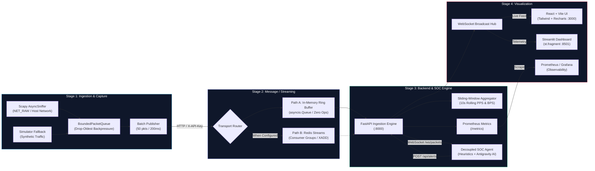
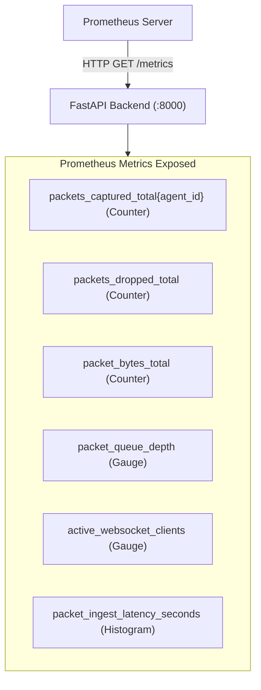
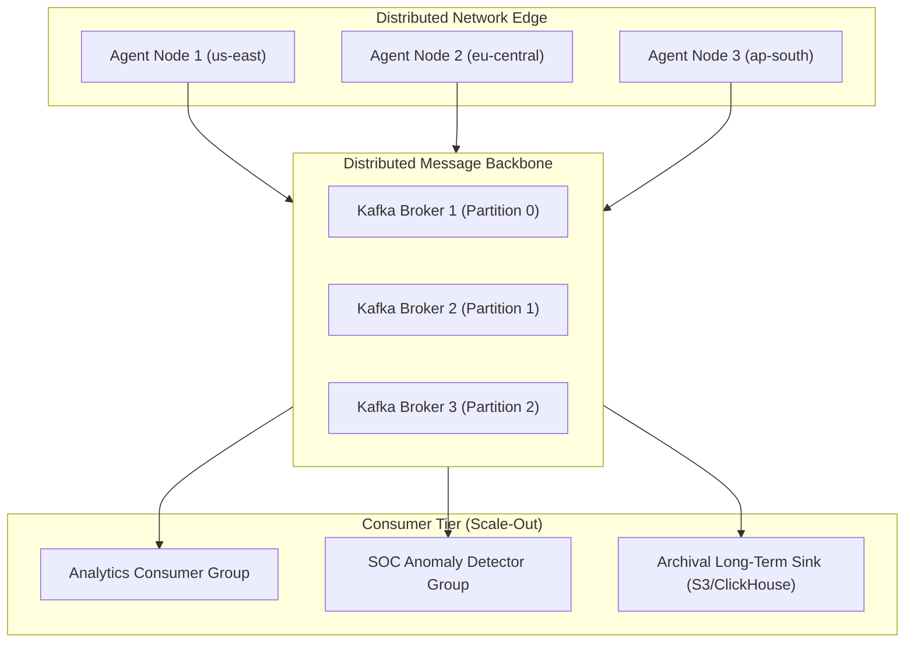

# System Architecture & Technical Specifications

**Network Packet Analyzer Platform**  
*Decoupled High-Throughput Ingestion, Streaming Analytics & Autonomous Threat Detection*

---

## 1. High-Level Architecture: "Capture → Stream → Consume → Visualize"

The platform implements an asynchronous, four-stage decoupled pipeline designed for high-availability telemetry processing, zero packet drops under burst conditions, and real-time dashboard observability.

---

## 2. Pipeline Stages Deep-Dive

### Stage 1: Standalone Packet Capture Agent (`agent/capture.py`)
- **Isolation:** Runs as an independent process/container with strictly minimal capabilities (`CAP_NET_RAW`, `CAP_NET_ADMIN`). Never blocks visualization or API threads.
- **L3/L4 Privacy Invariant:** Strictly inspects Ethernet, IPv4/IPv6, TCP, UDP, and ICMP headers. **Full application payload inspection is strictly rejected** to comply with corporate privacy, GDPR, and ethical network monitoring standards.
- **Bounded Queue & Backpressure:**
  - Internally buffers captured records into a thread-safe `BoundedPacketQueue`.
  - When traffic bursts exceed transmission capacity, applies **Drop-Oldest Backpressure** (FIFO eviction), incrementing `packets_dropped_total` rather than ballooning RAM or causing kernel socket buffer overflows.
- **Batch Dispatcher:** Assembles packets into micro-batches (50 packets or 200ms windows), amortizing HTTP/TCP handshake and serialization overhead.

### Stage 2: Streaming & Message Broker Layer (`backend/stream.py`)
The platform supports dual streaming paths tailored for demonstration and enterprise deployment:

| Criterion | Path A: In-Memory Ring Buffer (Default Demo) | Path B: Redis Streams (Scale Path) |
| :--- | :--- | :--- |
| **Operational Overhead** | Zero external dependencies; in-process `asyncio.Queue` | Requires Redis 7+ instance |
| **Throughput Target** | 10,000 – 50,000 PPS | 100,000 – 250,000 PPS |
| **Consumer Groups** | No (fan-out via broadcast list) | Yes (`XREADGROUP`, multi-consumer load balancing) |
| **Persistence / Replay** | Rolling in-memory window (max 10,000 records) | Disk persistence (AOF/RDB), stream replay |
| **Failure Mode** | Graceful FIFO eviction | Configurable retention (`MAXLEN ~ 100000`) |

### Stage 3: Backend API Engine (`backend/main.py`)
- **FastAPI Core:** Async request handling with ASGI concurrency (`uvicorn`).
- **REST Endpoints:**
  - `GET /health`: Diagnostic health, buffer queue depth, active client count, Redis status.
  - `GET /api/stats`: Sliding-window statistics (PPS, BPS, protocol distribution, top talkers).
  - `POST /api/ingest`: Agent ingestion endpoint protected by `X-API-Key` validation.
  - `GET /api/alerts` & `POST /api/alerts`: Incident storage and query endpoint.
- **WebSocket Feed (`/ws/packets`):** Push-based delivery. Disconnected clients are safely cleaned without blocking publisher throughput.
- **Autonomous SOC Agent (`agent/soc_agent.py`):**
  - Consumes the WebSocket feed as an independent subscriber.
  - Evaluates traffic patterns against heuristic rules (`DoS / FLOOD`, `PORT SCAN`, `SSH BRUTE FORCE`, `XMAS SCAN`, `MALICIOUS FILE`).
  - Queries Google Antigravity SDK (Gemini AI) for automated incident triage and tactical recommendations.

### Stage 4: Visualization Layer (`frontend/`)
- **React + Vite Dashboard:**
  - Wireshark-inspired dark theme with responsive typography and high-contrast telemetry.
  - Real-time scrolling packet table with protocol filtering and instant packet inspector.
  - Recharts interactive widgets: Throughput history, L4 protocol breakdown, and Top 5 talkers.
  - Native WebSocket consumer with exponential backoff auto-reconnect.

---

## 3. Prometheus Observability Specification

The `/metrics` endpoint exposes production-grade Prometheus metrics:

### Metrics Table
| Metric Name | Type | Description | Alerting Threshold |
| :--- | :--- | :--- | :--- |
| `packets_captured_total` | Counter | Total packets received by backend | `rate(...) == 0` for > 60s (agent down) |
| `packets_dropped_total` | Counter | Packets dropped due to buffer backpressure | `rate(...) > 100` (buffer undersized) |
| `packet_bytes_total` | Counter | Cumulative byte volume ingested | N/A (Bandwidth tracking) |
| `packet_queue_depth` | Gauge | Packets currently queued in sliding window | `> 9000` (impending drop) |
| `active_websocket_clients` | Gauge | Active dashboard WebSocket connections | `< 1` during active monitoring |
| `packet_ingest_latency_seconds` | Histogram | Latency distribution of packet ingestion | `P99 > 100ms` (backend saturation) |

---

## 4. High-Throughput Scaling & Apache Kafka Migration Path

For massive enterprise deployments aiming for **400,000+ Queries/Packets Per Second (QPS)** across distributed network edge nodes:

### Migration Triggers
Migrate from Path B (Redis Streams) to Apache Kafka when:
1. **Multi-Region Ingestion:** Thousands of remote capture probes streaming to a centralized telemetry lake.
2. **Partitioned Ingestion:** Parallel consumer group processing required per IP subnet partition.
3. **Multi-Day Retention:** Retaining multi-terabyte raw packet metadata logs on disk for historical threat hunting without memory pressure.
4. **Throughput Ceiling:** Single-node Redis Stream network saturation (> 250,000 PPS).

---

## 5. Security & Least Privilege Posture

1. **Host Privilege Containment:** The capture container requests `cap_add: [NET_RAW, NET_ADMIN]` rather than running as `--privileged` or root user.
2. **API Authentication:** Ingest and alert endpoints require `X-API-Key` headers validated at the API gateway layer.
3. **Payload Zero-Trust:** All packet parsing logic isolates header offsets; payload bytes are never extracted, logged, or serialized.
