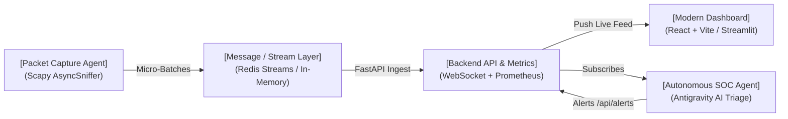

# 🛡️ Dynamic Network Packet Analyzer & SOC Threat Monitor

[](https://www.python.org/)
[](https://fastapi.tiangolo.com/)
[](https://react.dev/)
[](https://www.docker.com/)
[](https://prometheus.io/)
[](https://opensource.org/licenses/MIT)

A high-throughput, enterprise-grade network packet analysis platform engineered with a decoupled **"Capture → Stream → Consume → Visualize"** architecture. Features live L3/L4 metadata sniffing, bounded queue backpressure, Redis/In-Memory streaming, Prometheus observability, and an autonomous AI-driven SOC triage agent.

---

## 🏛️ Target Architecture



For complete technical specifications, mathematical latency modeling, and Kafka migration plans, see [ARCHITECTURE.md](ARCHITECTURE.md).

---

## ✨ Key Features

- **Decoupled Architecture:** Capture agent, streaming broker, REST/WebSocket API, and UI run as separate services.
- **Strict Privacy Compliance:** Inspects only L3/L4 network headers (IPs, ports, flags, protocols). **Zero packet payload inspection.**
- **Bounded Queue & Backpressure:** Resilient FIFO drop-oldest mechanism protects the agent from memory starvation during high-PPS bursts.
- **Dual Streaming Modes:**
  - **Path A (Zero Ops Demo):** High-speed in-memory ring buffer with `asyncio.Queue` broadcast.
  - **Path B (Enterprise Scale):** Redis Streams (`XADD`, consumer groups, replayable persistence).
- **Wireshark-Inspired UI:** High-contrast dark React dashboard with live scrolling packet table, protocol pie breakdown, throughput line charts, and packet inspector.
- **AI-Powered SOC Agent:** Decoupled heuristic detector with Google Antigravity SDK (Gemini AI) automated attack explanations.
- **Production Observability:** Native `/metrics` Prometheus exposition endpoint tracking PPS, bytes, queue depth, active clients, and P99 latency.

---

## 🚀 Quickstart: Live Demo via Docker Compose

Spin up the entire ecosystem (Redis, FastAPI, Capture Agent, SOC Agent, React UI) with a single command:

```bash
# 1. Clone repository
git clone https://github.com/PruthvirajPatil04-cy/Network-packet-analyzer-.git
cd Network-packet-analyzer-

# 2. (Optional) Set your Gemini API key for AI SOC triage
export GEMINI_API_KEY="your-gemini-api-key"

# 3. Launch the containerized platform
docker compose up --build
```

### Access Points:
| Service | URL | Description |
| :--- | :--- | :--- |
| **React Dashboard** | [http://localhost:3000](http://localhost:3000) | Live interactive Wireshark-style monitoring UI |
| **Backend API Docs** | [http://localhost:8000/docs](http://localhost:8000/docs) | OpenAPI interactive Swagger documentation |
| **Prometheus Metrics**| [http://localhost:8000/metrics](http://localhost:8000/metrics)| Real-time system telemetry and P99 latencies |
| **Health Diagnostic** | [http://localhost:8000/health](http://localhost:8000/health)  | Liveness/readiness probe |
| **Streamlit UI** | [http://localhost:8501](http://localhost:8501) | Legacy Streamlit UI (`docker compose --profile streamlit up`) |

---

## 🛠️ Local Development Setup (Manual)

If running directly without Docker:

### 1. Prerequisites
- Python 3.11+
- Node.js 18+ & npm
- (Optional) Npcap/WinPcap on Windows or `libpcap` on Linux for physical network capture. (The agent automatically defaults to high-fidelity simulated traffic if physical sniffing permissions are absent).

### 2. Backend & Streaming Server
```bash
# Install Python dependencies
pip install -r requirements.txt

# Start FastAPI backend
uvicorn backend.main:app --host 0.0.0.0 --port 8000 --reload
```

### 3. Packet Capture Agent (Standalone Service)
In a second terminal:
```bash
# Run capture agent
python -m agent.capture
```

### 4. Autonomous SOC Detection Agent
In a third terminal:
```bash
# Run SOC agent
python -m agent.soc_agent
```

### 5. Frontend Dashboard (React + Vite)
In a fourth terminal:
```bash
cd frontend
npm install
npm run dev
# Dashboard opens on http://localhost:3000
```

---

## 🧪 Automated Testing

Run the full automated test suite (54 unit and integration tests covering queue backpressure, Pydantic validation, FastAPI endpoints, WebSocket broadcasting, and anomaly heuristics):

```bash
python -m pytest tests -v
```

---

## 🔒 Security & Least Privilege

- **Least Privilege:** Docker capture agents require only `NET_RAW` and `NET_ADMIN` capabilities rather than full `--privileged` access.
- **API Key Guard:** Ingest and alert submission endpoints require validation via the `X-API-Key` header.
- **Payload Exclusion:** The system strictly parses network headers. No application data, payloads, or session cookies are stored or broadcast.

---

## 📜 License
Distributed under the MIT License. See `LICENSE` for more information.
