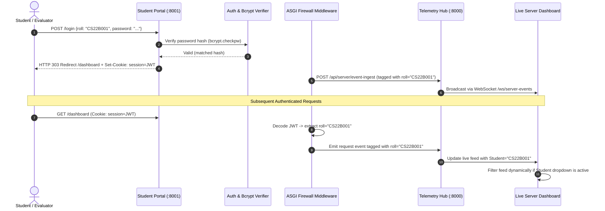

# University Student Portal — Demo Credentials & Authentication Reference

This document provides the reference credentials for the 10 university student accounts seeded into the simulated Apex University portal (`student.college.edu` on port `8001`).

> [!NOTE]
> **Demo accounts — for evaluation only.**
> Never use these credentials or hardcoded credential patterns in production environments.
> The demo portal hashes all passwords with **bcrypt (12 rounds)** at seed time. Passwords are never stored in plaintext within the database or application code.

---

## 1. Seeded Student Roster & Assigned Campus IPs

Each student account is assigned a dedicated campus IP address based on university department subnets (CSE: `10.20.1.x`, ECE: `10.20.2.x`, Mech: `10.20.3.x`, EEE: `10.20.4.x`). When testing locally or interacting through a browser, the demo server automatically maps requests from the authenticated student session to their assigned campus IP so that every student appears with their distinct IP address in the SOC Dashboard and Packet Telemetry feed.

| Roll Number | Full Name | Campus IP | Academic Program | Year | College Email | Plaintext Password | Fee Status | Fee Due |
|---|---|:---:|---|:---:|---|---|:---:|---:|
| `CS22B001` | Aarav Sharma | `10.20.1.101` | B.Tech CSE | 3 | `aarav.sharma@college.edu` | `Aarav@2024` | Paid | ₹0 |
| `CS22B002` | Priya Nair | `10.20.1.102` | B.Tech CSE | 3 | `priya.nair@college.edu` | `Priya@2024` | Paid | ₹0 |
| `CS22B003` | Rohan Mehta | `10.20.1.103` | B.Tech CSE | 3 | `rohan.mehta@college.edu` | `Rohan@2024` | Partial | ₹15,000 |
| `EC22B004` | Ananya Iyer | `10.20.2.104` | B.Tech ECE | 3 | `ananya.iyer@college.edu` | `Ananya@2024` | Paid | ₹0 |
| `EC22B005` | Vikram Reddy | `10.20.2.105` | B.Tech ECE | 3 | `vikram.reddy@college.edu` | `Vikram@2024` | Paid | ₹0 |
| `ME22B006` | Sneha Kulkarni | `10.20.3.106` | B.Tech Mech | 3 | `sneha.kulkarni@college.edu` | `Sneha@2024` | Paid | ₹0 |
| `ME22B007` | Karthik Rao | `10.20.3.107` | B.Tech Mech | 3 | `karthik.rao@college.edu` | `Karthik@2024` | Partial | ₹22,000 |
| `CS21B008` | Isha Patel | `10.20.1.108` | B.Tech CSE | 4 | `isha.patel@college.edu` | `Isha@2024` | Paid | ₹0 |
| `CS21B009` | Aditya Verma | `10.20.1.109` | B.Tech CSE | 4 | `aditya.verma@college.edu` | `Aditya@2024` | Unpaid | ₹45,000 |
| `EE22B010` | Meera Joshi | `10.20.4.110` | B.Tech EEE | 3 | `meera.joshi@college.edu` | `Meera@2024` | Paid | ₹0 |

---

## 2. Authentication Flow & JWT Session Architecture

The portal uses standard RFC 7519 JSON Web Tokens (JWT) signed with HMAC-SHA256 (`HS256`). When a student authenticates, the token payload `{roll, name, exp}` is packaged into an HTTP-only session cookie. The ASGI security middleware inspects this token on every subsequent request to dynamically associate network telemetry events with student identities.



---

## 3. CLI Testing via `curl`

### Authenticate and Save Session Cookie
```bash
curl -i -c cookies.txt \
  -d "roll=CS22B001&password=Aarav@2024" \
  http://localhost:8001/login
```

### Access Protected Academic Dashboard
```bash
curl -i -b cookies.txt http://localhost:8001/dashboard
```

### Inspect Enrolled Courses
```bash
curl -i -b cookies.txt http://localhost:8001/courses
```

### Check Deterministic Grades & Exam Results
```bash
curl -i -b cookies.txt http://localhost:8001/results
```

### Check Fee Balance
```bash
curl -i -b cookies.txt http://localhost:8001/fees
```

---

## 4. Security Notes
1. **Bcrypt Salt Rounds:** 12 rounds per password hash.
2. **Session Cookie Security:** Marked `HttpOnly` and `SameSite=Lax`.
3. **Cross-Student Isolation:** Protected endpoints derive student identity exclusively from the validated cryptographic session JWT. Direct parameter tampering (`?roll=CS22B002`) is strictly rejected.
4. **Brute Force Protection:** 6 consecutive failed attempts from the same IP result in immediate application-layer firewall blacklisting (HTTP 403, 300s TTL).
