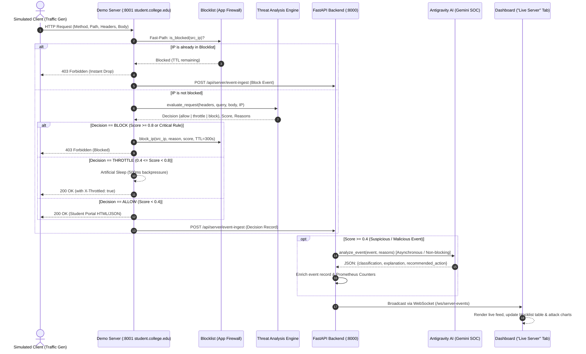

# 🎓 Live Server & Dynamic Threat Defense Specification

**Simulated Student Portal (`student.college.edu`) & Real-Time Application Firewall**

---

## 1. Architectural Telemetry Flow



---

## 2. Dashboard "Live Server" Tab Layout (ASCII Mockup)

```text
+-------------------------------------------------------------------------------------------------------------------------+
| [CYBER-DEFENSE PACKET ANALYZER v2.0]        [Tabs: Network Telemetry | *Live Server: student.college.edu*]   [/metrics]  |
+-------------------------------------------------------------------------------------------------------------------------+
| CONNECTION STATUS BANNER                                                                                                |
| +-------------------------+ +-------------------------+ +-------------------------+ +---------------------------------+ |
| | TARGET: student.college | | FASTAPI HUB             | | CAPTURE AGENT           | | DYNAMIC FIREWALL                | |
| | (•) ONLINE (Port :8001) | | (•) p50: 3.8ms | p99:11 | | (•) ONLINE & SNIFFING   | | 5 Blocked IPs (TTL 300s)        | |
| +-------------------------+ +-------------------------+ +-------------------------+ +---------------------------------+ |
+-------------------------------------------------------------------------------------------------------------------------+
| LIVE INGRESS REQUEST STREAM (Left 2/3)              | ATTACK ACTIVITY (Rolling 15m) (Right 1/3)                         |
| Time     IP          Method Path         Decision   | [==== SQL Injection: 14                                         ] |
| 14:02:11 10.0.5.99   POST   /login       [🔴 BLOCK] | [=== Brute Force: 8                                             ] |
| 14:02:10 10.0.1.14   GET    /dashboard   [🟢 ALLOW] | [== Path Traversal: 4                                           ] |
| 14:02:09 10.0.5.105  POST   /login       [🔴 BLOCK] | [== XSS Probe: 3                                                ] |
| 14:02:08 10.0.1.22   GET    /courses     [🟢 ALLOW] |                                                                 |
| 14:02:07 10.0.5.120  GET    /results     [🔴 BLOCK] | SIMULATED FIREWALL BLOCKLIST                                    |
| --------------------------------------------------- | IP           TTL   Hits   Action                                |
| EVENT INSPECTOR (Drawer on row click)               | 10.0.5.99    284s  12     [Unblock]                             |
| IP: 10.0.5.99 | Score: 1.00 | Severity: CRITICAL    | 10.0.5.105   241s  6      [Unblock]                             |
| Reason: SQL Injection signature (UNION SELECT)      | 10.0.5.120   190s  4      [Unblock]                             |
| [Sparkles] Antigravity AI Forensic Triage:          | [+ Block IP: [          ] [Block]]                              |
| "Attempted auth bypass via SQLi targeting login."   +-------------------------------------------------------------------+
+-------------------------------------------------------------------------------------------------------------------------+
| DEMO CONTROLS TOOLBAR                                                                                                   |
| Mode: [Benign (100% Students)] [*Mixed (80% Benign + 20% Attacks)*] | Rate: [10] [20*] [50] [100] req/s                      |
| [⚡ Inject Test Attack]  [Clear Blocklist]  [Open Student Portal (New Tab)]                                             |
+-------------------------------------------------------------------------------------------------------------------------+
```

---

## 3. Detection Rule Matrix

| Signature / Heuristic | Tier | Severity | Score Delta | Primary Trigger Pattern | Action Taken |
| :--- | :--- | :--- | :--- | :--- | :--- |
| **SQL Injection (SQLi)** | Tier 1 | `CRITICAL` | `+1.00` | `UNION SELECT`, `' OR '1'='1`, `; DROP TABLE`, `--` comment | **Instant Block (403)** + IP Blocklisted |
| **Path Traversal (LFI)** | Tier 1 | `CRITICAL` | `+1.00` | `../`, `..%2f`, `%2e%2e%2f`, `/etc/passwd`, `/etc/shadow` | **Instant Block (403)** + IP Blocklisted |
| **OS Command Injection** | Tier 1 | `CRITICAL` | `+1.00` | `; whoami`, `\| cat`, `$(...)`, backticks, `&& ls` | **Instant Block (403)** + IP Blocklisted |
| **Cross-Site Scripting** | Tier 1 | `HIGH` | `+0.85` | `<script`, `onerror=`, `javascript:`, `<svg/onload` | **Instant Block (403)** + IP Blocklisted |
| **Known Exploit Scanners**| Tier 1 | `HIGH` | `+0.85` | User-Agent: `sqlmap`, `nikto`, `masscan`, `gobuster` | **Instant Block (403)** + IP Blocklisted |
| **Admin Honeypot Access**| Tier 1 | `HIGH` | `+0.90` | Direct request to `/admin` without secret token | **Instant Block (403)** + IP Blocklisted |
| **Scanning Endpoints** | Tier 1 | `MEDIUM` | `+0.70` | Probing `/wp-admin`, `/phpmyadmin`, `/.env`, `/.git` | **Throttle / Block on Repeat** |
| **Credential Brute Force**| Tier 2 | `HIGH` | `+0.85` | > 5 failed `POST /login` attempts from 1 IP in 60s | **Dynamic Block (403)** + IP Blocklisted |
| **High-Rate Flooding** | Tier 2 | `HIGH` | `+0.85` | > 100 requests in 10s from single IP | **Dynamic Block (403)** + IP Blocklisted |
| **Port Scanning (Horizontal)**| Tier 2 | `MEDIUM` | `+0.65` | > 15 distinct ports accessed from 1 IP in 30s | **Throttle (500ms delay)** |
| **Traffic Burst Shape** | Tier 2 | `HIGH` | `+0.80` | > 50 requests in 5s (SYN-flood simulation) | **Dynamic Block (403)** + IP Blocklisted |
| **Path Fuzzing (404s)** | Tier 2 | `MEDIUM` | `+0.60` | > 20 non-existent endpoints requested in 60s | **Throttle (500ms delay)** |

---

## 4. Prometheus Metric Definitions

The Live Server adds the following metrics to `/metrics`:

```prometheus
# HELP demo_server_requests_total Total requests evaluated by demo server
# TYPE demo_server_requests_total counter
demo_server_requests_total{decision="allow"} 1420
demo_server_requests_total{decision="throttle"} 34
demo_server_requests_total{decision="block"} 128

# HELP demo_server_blocked_ips Currently blocked source IP count in firewall blocklist
# TYPE demo_server_blocked_ips gauge
demo_server_blocked_ips 4

# HELP threat_engine_score_histogram Distribution of threat analysis scores
# TYPE threat_engine_score_histogram histogram
threat_engine_score_histogram_bucket{le="0.1"} 1410
threat_engine_score_histogram_bucket{le="0.4"} 1435
threat_engine_score_histogram_bucket{le="0.8"} 1460
threat_engine_score_histogram_bucket{le="1.0"} 1582
threat_engine_score_histogram_sum 148.5
threat_engine_score_histogram_count 1582

# HELP antigravity_explanations_total Total AI threat explanations generated via Antigravity SDK
# TYPE antigravity_explanations_total counter
antigravity_explanations_total 42
```

---

## 5. How to Demo This in an Interview (Talking Script)

### Step 1: Open the Architecture & Live Dashboard
- **Screen:** Open `http://localhost:8000` and switch to the **"Live Server (student.college.edu)"** tab.
- **Narrative:** 
  > *"Here we have an end-to-end simulated college student portal deployed at `student.college.edu` on port 8001. Rather than just analyzing passive PCAP traces, this system actively inspects HTTP application traffic in real time with an embedded threat engine and application firewall."*

### Step 2: Show the Real-Time Request Stream
- **Screen:** Point to the Live Request Feed showing green `ALLOW` badges for benign students.
- **Narrative:**
  > *"In the live request table, you can see simulated students navigating the portal: browsing the course catalog, checking semester grades, and reviewing tuition fees. Every request emits telemetry with millisecond timestamps, source IPs, and size metrics."*

### Step 3: Trigger Live Threat Detection
- **Screen:** Click the **"⚡ Inject Test Attack"** button or toggle `Mixed Mode`.
- **Observation:** Notice the row with a red left border and a 🔴 `BLOCK` badge appear within 1 second.
- **Narrative:**
  > *"When an attacker injects an SQL injection payload (`admin' OR '1'='1`) into the login form, the Threat Engine's Tier-1 deterministic matcher scores it at 1.0. The request is immediately rejected with HTTP 403, and the source IP `10.0.5.222` is dynamically registered in the in-memory firewall blocklist with a 300-second TTL."*

### Step 4: Inspect the AI SOC Forensic Drawer
- **Screen:** Click the blocked row to open the Event Inspector drawer.
- **Narrative:**
  > *"Because the event scored ≥ 0.4, it triggered our asynchronous Antigravity AI layer powered by Gemini. Notice how it forensicates the attack: classifying it as malicious, generating a plain-English explanation, and recommending the specific mitigation without blocking the web server thread."*

### Step 5: Test the Fast-Path Firewall & Unblock
- **Screen:** Show the Blocklist panel in the bottom right with active TTL countdowns. Click **"Unblock"** on an IP.
- **Narrative:**
  > *"Any subsequent packets from that IP are dropped on the fast-path before route processing, preserving CPU cycles. Administrators can review active firewall rules and unblock IPs with a single click via our REST API."*
