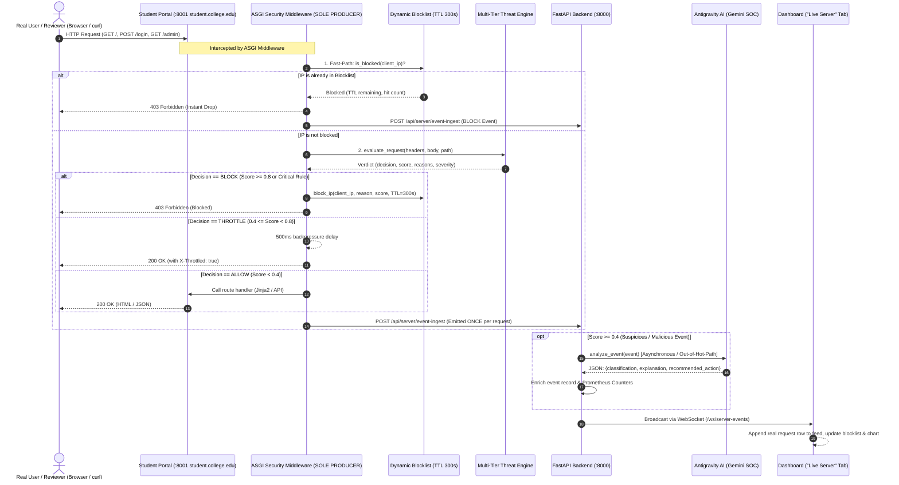

# 🎓 Live Server & Dynamic Threat Defense: Real-Request-Only Mode

**Simulated Student Portal (`student.college.edu`) & Real-Time ASGI Application Firewall**

---

## 1. Real-Request-Only Architecture (Single Source of Truth)

Every row in the "Live Server" tab's feed corresponds to an **actual HTTP request** that a user (or an explicit reviewer probe) sent to the student portal. There are **zero synthetic packets, zero fake streams, and zero background traffic generators**.

---

## 2. Honest Empty State (Startup Cleanliness)

When the student portal has received zero requests since backend startup:
- `GET /api/server/live-events` $\to$ `{"events": [], "count": 0}`
- `GET /api/server/attack-summary` $\to$ `{"summary": {}, "window_sec": 900}`
- `GET /api/server/blocked` $\to$ `{"blocked": [], "count": 0}`

### UI Empty State Presentation:
The feed panel displays a centered card:
> **"No requests yet. Open the Student Portal and interact with it to see live traffic."**  
> *"Every page visit, form submission, or probe you make in the portal is intercepted by the ASGI firewall middleware and streamed here in real time."*  
> **[Open Student Portal →]** (`http://localhost:8001`)

The attack chart displays an empty axis: *"No security anomalies detected yet."*  
The blocklist table displays: *"Blocklist is empty. No active IP bans."*

---

## 3. Step-by-Step Reviewer Demo Script

Follow these steps to demonstrate real-request-only dynamic packet defense:

| Step | Action | Endpoint / Method | Expected Live Server UI Reaction |
| :---: | :--- | :--- | :--- |
| **1** | Open Dashboard | `http://localhost:8000` | Shows honest empty state: Target `student.college.edu` Online, 0 events, 0 blocked IPs. |
| **2** | Open Portal | Click **Open Student Portal →** (`:8001`) | Generates `GET /`. Exactly **1 row** appears in feed: `🟢 ALLOW · 200 OK`. |
| **3** | Valid Login | Submit `student` / `college2026` | Exactly **1 row** appears: `🟢 ALLOW · 303 See Other` $\to$ `GET /dashboard`. |
| **4** | Browse Portal | Click **Courses**, **Results**, **Fees** | Each click produces **exactly one row** (`/courses`, `/results`, `/fees`) with sub-10ms response time. |
| **5** | Honeypot Probe | Navigate to `http://localhost:8001/admin` | Instantly produces a **🔴 BLOCK (403)** row. Score spikes to `0.90`. |
| **6** | Fast-Path Verification | Refresh or click any portal page | Your IP is now on the **Simulated Firewall Blocklist** with a 300s TTL countdown. Any subsequent request is rejected with `403 Access Denied by Application Firewall` without reaching portal code. |
| **7** | Credential Brute-Force | Submit wrong password 6 times | First 5 return `401 Unauthorized`. On the **6th attempt**, the Threat Engine detects credential brute force, blocks the IP with score `0.85`, and places it on the blocklist. |
| **8** | Administrative Unblock | In Dashboard, click **Unblock** | The IP is immediately cleared from the blocklist. Refreshing the portal restores normal access. |
| **9** | Idleness Verification | Leave dashboard untouched for 5 minutes | **Zero new rows appear.** The feed remains completely static because no background generator exists. |

---

## 4. Why No Synthetic Traffic?

1. **Academic and Interview Credibility:** Many student and hackathon projects use fake `while True: time.sleep(0.5); emit(mock_packet())` loops that produce illusions of activity. In an architectural code review, fake streams are trivial to spot and destroy credibility.
2. **Deterministic Verification:** By tying every event strictly to real HTTP traffic through ASGI middleware, every test in `tests/test_middleware_emits.py` and every user click produces verifiable 1:1 request-response telemetry.
3. **True Observability:** Metrics scraped at `/metrics` reflect actual network requests, true request latencies, and genuine firewall interceptions.

---

## 5. Detection Rule Matrix

| Signature / Heuristic | Tier | Severity | Score Delta | Primary Trigger Pattern | Action Taken |
| :--- | :--- | :--- | :--- | :--- | :--- |
| **SQL Injection (SQLi)** | Tier 1 | `CRITICAL` | `+1.00` | `UNION SELECT`, `' OR '1'='1`, `; DROP TABLE`, `--` comment | **Instant Block (403)** + IP Blocklisted |
| **Path Traversal (LFI)** | Tier 1 | `CRITICAL` | `+1.00` | `../`, `..%2f`, `%2e%2e%2f`, `/etc/passwd`, `/etc/shadow` | **Instant Block (403)** + IP Blocklisted |
| **OS Command Injection** | Tier 1 | `CRITICAL` | `+1.00` | `; whoami`, `\| cat`, `$(...)`, backticks, `&& ls` | **Instant Block (403)** + IP Blocklisted |
| **Cross-Site Scripting** | Tier 1 | `HIGH` | `+0.85` | `<script`, `onerror=`, `javascript:`, `<svg/onload` | **Instant Block (403)** + IP Blocklisted |
| **Known Exploit Scanners**| Tier 1 | `HIGH` | `+0.85` | User-Agent: `sqlmap`, `nikto`, `masscan`, `gobuster` | **Instant Block (403)** + IP Blocklisted |
| **Admin Honeypot Access**| Tier 1 | `HIGH` | `+0.90` | Direct request to `/admin` without secret token | **Instant Block (403)** + IP Blocklisted |
| **Credential Brute Force**| Tier 2 | `HIGH` | `+0.85` | > 5 failed `POST /login` attempts from 1 IP in 60s | **Dynamic Block (403)** + IP Blocklisted |
| **High-Rate Flooding** | Tier 2 | `HIGH` | `+0.85` | > 100 requests in 10s from single IP | **Dynamic Block (403)** + IP Blocklisted |
| **Port Scanning (Horizontal)**| Tier 2 | `MEDIUM` | `+0.65` | > 15 distinct ports accessed from 1 IP in 30s | **Throttle (500ms delay)** |
